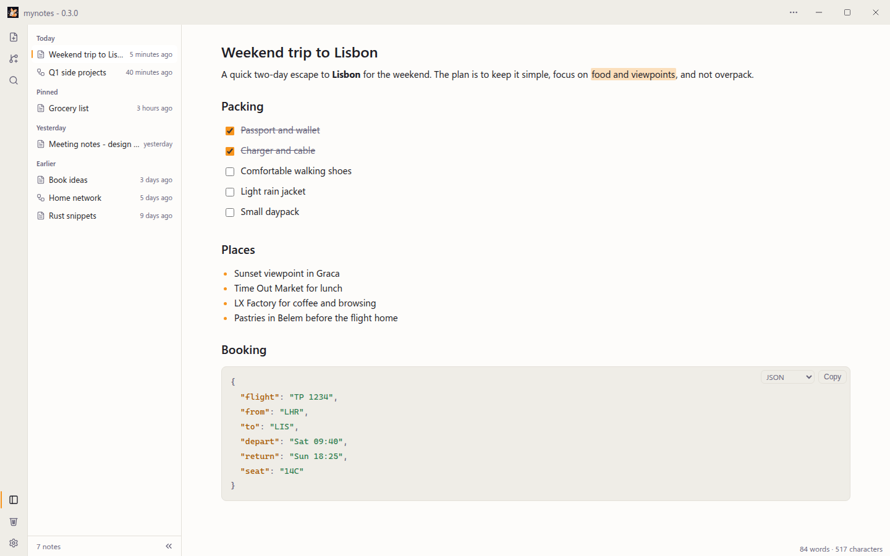
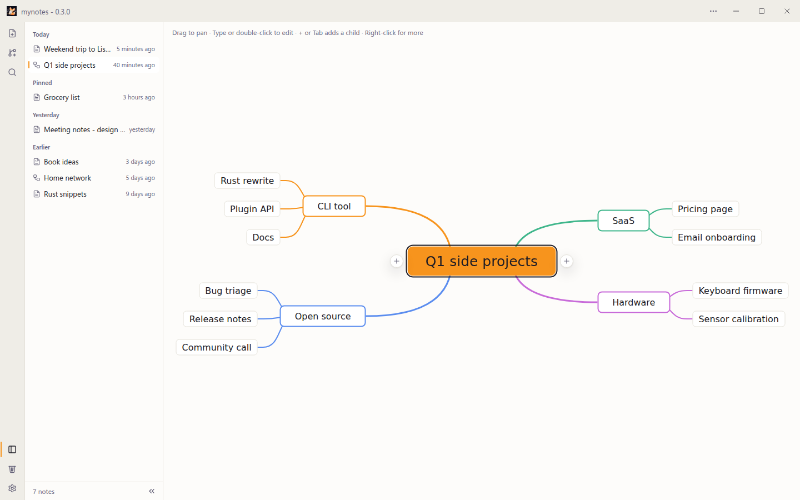
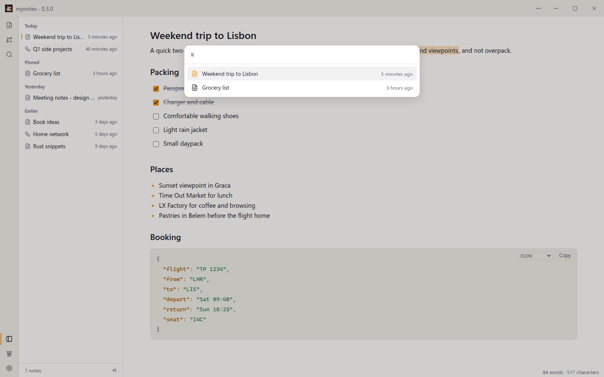

<p align="center"></p>

# mynotes

[](VIBECODING.md)

A Windows notepad that opens in about 0.3 s, waits in the tray at 0 % CPU and remembers your notes without files: rich text, pasted images and mind maps, local only. Built with Tauri 2 and Svelte 5.

**[Download for Windows](https://github.com/ikarys/mynotes/releases/latest)** (2.2 MB) · [Website](https://ikarys.github.io/mynotes/)

<picture>
  <source media="(prefers-color-scheme: dark)" srcset="docs/assets/screenshots/note-dark.png">
  
</picture>

Measured: opens in 313 ms (median of 7 launches, Windows 11, v0.2.0), 0 % CPU at rest, 4.4 MB app, 2.2 MB installer; method in [VERIFICATION.md](VERIFICATION.md).

## Install (Windows 10/11, x64)

Download from [Releases](https://github.com/ikarys/mynotes/releases):

- `…-setup.exe` installs for the current user (no admin rights), adds a Start menu entry and an uninstaller. Uninstalling removes the app, its shortcuts and its autostart entry. Your notes are kept unless you tick "Delete the application data".
- `…-portable.exe` runs from anywhere, nothing installed.

Both are unsigned, so Windows SmartScreen warns on first launch: click "More info", then "Run anyway". `SHA256SUMS` lets you check the download.

## Use

### Notes

The notes list on the left shows every note, grouped by day; the icon at the bottom of the left bar hides it.

| Shortcut | Action |
| --- | --- |
| <kbd>Ctrl</kbd>+<kbd>N</kbd> | New note |
| <kbd>Ctrl</kbd>+<kbd>Shift</kbd>+<kbd>M</kbd> | New mind map |
| <kbd>Ctrl</kbd>+<kbd>W</kbd> | Close the note |
| <kbd>Ctrl</kbd>+<kbd>Tab</kbd> | Next note in the list |
| <kbd>Ctrl</kbd>+<kbd>P</kbd> | Find a note (full-text search) |
| <kbd>Ctrl</kbd>+<kbd>O</kbd> | Open a `.md` or `.txt` file as a new note |
| <kbd>Ctrl</kbd>+<kbd>Shift</kbd>+<kbd>S</kbd> | Save the note as Markdown or plain text |
| <kbd>Ctrl</kbd>+<kbd>F</kbd> | Find text in the note |
| <kbd>Ctrl</kbd>+<kbd>H</kbd> | Find and replace |
| <kbd>Ctrl</kbd>+<kbd>,</kbd> | Open settings |
| <kbd>Ctrl</kbd>+<kbd>Alt</kbd>+<kbd>Space</kbd> | Show or hide the window (changeable) |

Closing a note keeps it in the list. `Move to trash` in the `…` menu hides it. The Trash (left bar) restores it or erases it for good, and notes left there are erased after 30 days.

Select text to format it; paste images or Markdown directly.

A <code>```markdown</code> code block has a Preview button to switch between its source and the rendered result. A code block's language (Markdown, JSON, YAML) can be changed from the selector at its top right; JSON and YAML are coloured.

Notes are saved automatically in `%APPDATA%\ovh.iks-homelab.mynotes` (`mynotes.db` and an `images` folder).

### Mind maps

<picture>
  <source media="(prefers-color-scheme: dark)" srcset="docs/assets/screenshots/mindmap-dark.png">
  
</picture>

<kbd>Tab</kbd> adds a child, <kbd>Enter</kbd> a sibling, <kbd>F2</kbd> renames, right-click for more. The `…` menu copies the note as Markdown and exports a mind map as PNG.

### Find

<picture>
  <source media="(prefers-color-scheme: dark)" srcset="docs/assets/screenshots/search-dark.png">
  
</picture>

<kbd>Ctrl</kbd>+<kbd>P</kbd> finds a note (full-text search). <kbd>Ctrl</kbd>+<kbd>F</kbd> finds text in the note. <kbd>Ctrl</kbd>+<kbd>H</kbd> finds and replaces.

### Window, settings and updates

<kbd>Ctrl</kbd>+<kbd>Alt</kbd>+<kbd>Space</kbd> (changeable in Settings) shows or hides the window from anywhere, even when minimized; closing the window keeps mynotes in the tray. The window reopens at the size and place you left it.

Settings (<kbd>Ctrl</kbd>+<kbd>,</kbd>) holds the theme, the font and size of note text, the show/hide shortcut, the update check and the data folder.

When a new version is out, the `…` menu shows `Update to vX`: the installed app updates and restarts itself, the portable exe opens the download page. The check runs a few seconds after start; turn it off in Settings.

## Develop (from WSL)

Needs Node 22+, Rust with the `x86_64-pc-windows-msvc` target, `cargo-xwin`, `clang`, `lld`, `llvm` and `just`.

```
npm install
just dev     # Vite in WSL + debug Windows exe with hot reload
just test
just lint
just build   # release exe
```

The screenshots are regenerated from the built UI with a mocked backend, see `scripts/screenshot-mock.js`.

AI assistance: this project is written with AI help, see [VIBECODING.md](VIBECODING.md).

How it is built and verified: [VERIFICATION.md](VERIFICATION.md).
Security: [SECURITY.md](SECURITY.md).

Licence: MIT.
