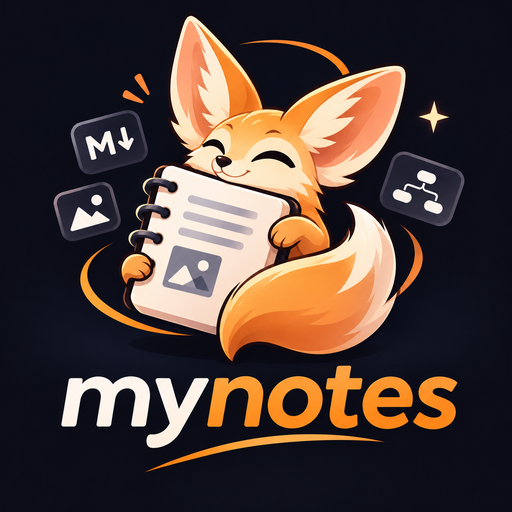

<p align="center"></p>

# mynotes

[](VIBECODING.md)

A Windows notepad that starts instantly and remembers your notes without
files, with rich text, pasted images and mind maps. Built with Tauri 2 and
Svelte 5.

## Use

- `Ctrl+N` new note, `Ctrl+Shift+M` new mind map, `Ctrl+W` close tab,
  `Ctrl+Tab` next tab, `Ctrl+P` find a note (full-text search).
- `Ctrl+O` opens a `.md` or `.txt` file as a new note; `Ctrl+Shift+S` saves
  the note as Markdown or plain text.
- Closing a tab keeps the note (find it again with `Ctrl+P`); `Delete note…`
  in the `…` menu removes it for good.
- Select text to format it; paste images or Markdown directly.
- A ```` ```markdown ```` code block has a Preview button to switch between
  its source and the rendered result.
- Mind map: `Tab` adds a child, `Enter` a sibling, `F2` renames,
  right-click for more.
- The `…` menu also copies the note as Markdown, exports a mind map as PNG,
  switches between system, light and dark themes, sets the font and size of
  note text, and opens the data folder.
- `Ctrl+Alt+Space` (changeable in the `…` menu) shows or hides the window from
  anywhere, even when minimized; closing the window keeps mynotes in the tray.

Notes are saved automatically in `%APPDATA%\ovh.iks-homelab.mynotes`
(`mynotes.db` and an `images` folder).

AI assistance: this project is written with AI help, see [VIBECODING.md](VIBECODING.md).

## Develop (from WSL)

Needs Node 22+, Rust with the `x86_64-pc-windows-msvc` target, `cargo-xwin`,
`clang`, `lld`, `llvm` and `just`.

```
npm install
just dev     # Vite in WSL + debug Windows exe with hot reload
just test
just lint
just build   # release exe
```

How it is built and verified: [VERIFICATION.md](VERIFICATION.md).
Security: [SECURITY.md](SECURITY.md).

Licence: MIT.
